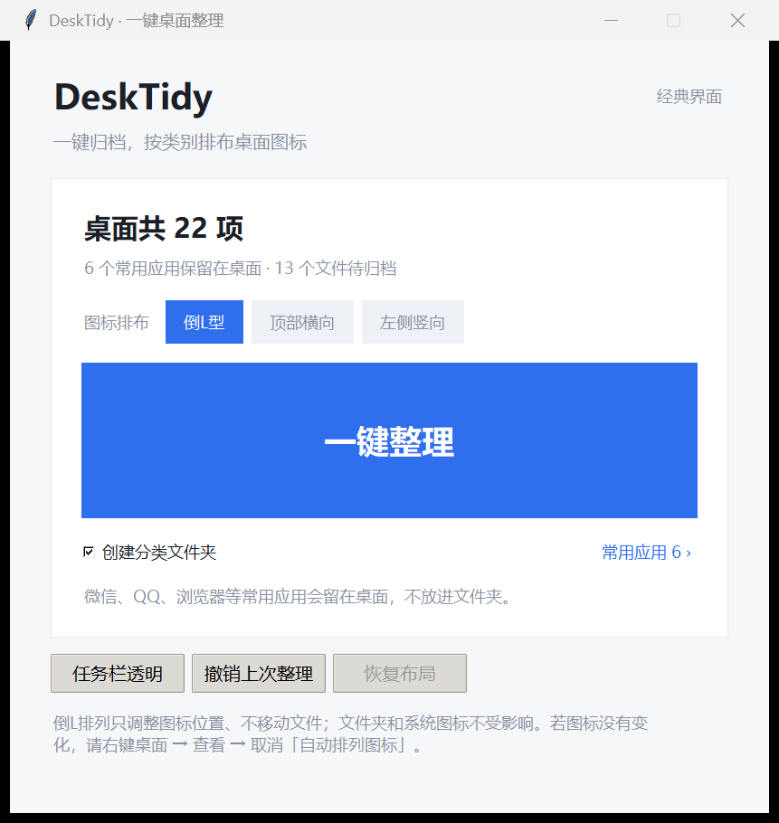

# DeskTidy · Windows 桌面整理工具

一键把散乱的桌面图标按类别归档到文件夹，并按类别排成倒 L 型。纯本地运行，不联网、不上传任何文件，所有移动都可撤销。

Windows 10 / 11 · Python 3.9+ · 无需第三方依赖（打包版免安装）



## 功能

- **一键整理**：扫描桌面（用户桌面 + 公共桌面），按关键词规则归类，移动到分类文件夹
- **图标排布**：倒 L 型 / 顶部横向 / 左侧竖向三种布局，只调整图标位置、不移动文件
- **整理预览**：执行前列出每个文件将去的文件夹，可取消；另有演练模式只预览不改动
- **常用应用保留**：微信、QQ、浏览器等常用应用留在桌面，支持自定义勾选清单
- **可撤销**：移动记录保留最近 50 次，可整批还原；排布前自动保存坐标快照，可一键恢复原布局
- **不建空文件夹**：只为真正要放入的项目创建文件夹，跳过或失败时回收空目录
- **任务栏半透明**：通过系统分层窗口接口设置，立即生效、无需重启、不装第三方软件
- **整理报告**：每次整理导出 CSV（类别、原路径、新路径、结果、耗时）
- **两套界面**：简洁模式（默认，一个大按钮）与经典模式（分类统计、逐项手动归类）

## 使用

### 下载免安装版

到 [Releases](https://github.com/Kedah-boya/DeskTidy/releases/latest) 下载 `DeskTidy-v1.0.0-win64.zip`，解压后双击 `DeskTidy.exe`。需要与 `_internal` 目录放在一起。

### 运行打包版

双击 `DeskTidy.exe`。首次启动会显示引导，建议先用演练模式看一遍效果。

### 从源码运行

```bash
python -m DeskTidy
```

或双击 `启动DeskTidy.bat`。

### 打包

```bash
pip install pyinstaller
pyinstaller --noconfirm --clean --windowed --onedir --name DeskTidy \
  --icon DeskTidy/icon.ico --add-data "DeskTidy/rules.json;DeskTidy" DeskTidy/launcher.py
```

产物在 `dist/DeskTidy/`，运行时需要与 `_internal` 目录放在一起。

## 自定义分类规则

编辑 `DeskTidy/rules.json`：

```json
{
  "categories": [
    {
      "name": "开发",
      "folder": "02-开发",
      "color": "#3b6ff5",
      "keywords": ["visual studio", "vscode", "pycharm", "git"],
      "extensions": [".py", ".sln", ".csproj"]
    }
  ]
}
```

- `folder` 为空字符串表示命中后留在桌面（常用应用即用此方式）
- 匹配权重：名称命中 3 分 > 快捷方式目标路径 2 分 > 扩展名 1 分
- 分类文件夹本身、系统图标（此电脑、回收站）不会被动

## 实现说明

| 模块 | 职责 |
| --- | --- |
| `scanner.py` | 枚举桌面项目、提取字段、过滤系统项、汇总 |
| `shelllink.py` | 通过 IShellLink COM 解析 `.lnk` 的真实目标、参数与图标；解析 `.url` |
| `classifier.py` | 关键词打分归类 |
| `organizer.py` | 生成移动计划、冲突改名、执行与撤销、报告 |
| `desktop_layout.py` | 通过桌面 SysListView32 读取图标名与坐标，按类别摆放 |
| `taskbar.py` | 任务栏分层窗口透明度开关 |
| `icons.py` | 提取 Shell 真实图标并转为 Tk 可用图像 |
| `app.py` | 经典界面 |
| `simple.py` | 简洁界面（默认） |

技术要点：图标位置通过 `LVM_GETITEMPOSITION` / `LVM_SETITEMPOSITION` 读写；任务栏透明用 `WS_EX_LAYERED` + alpha；所有文件操作限当前用户桌面，不申请管理员权限。

## 已知限制

- 任务栏透明会使背景与图标一起变透（系统未提供只透背景的公开接口），重启资源管理器后需重新开启
- 若桌面开启了「自动排列图标」，图标位置调整不会生效，需右键桌面 → 查看 → 取消勾选
- 仅在 Windows 10 / 11 测试，macOS / Linux 不支持

## 许可证

MIT
